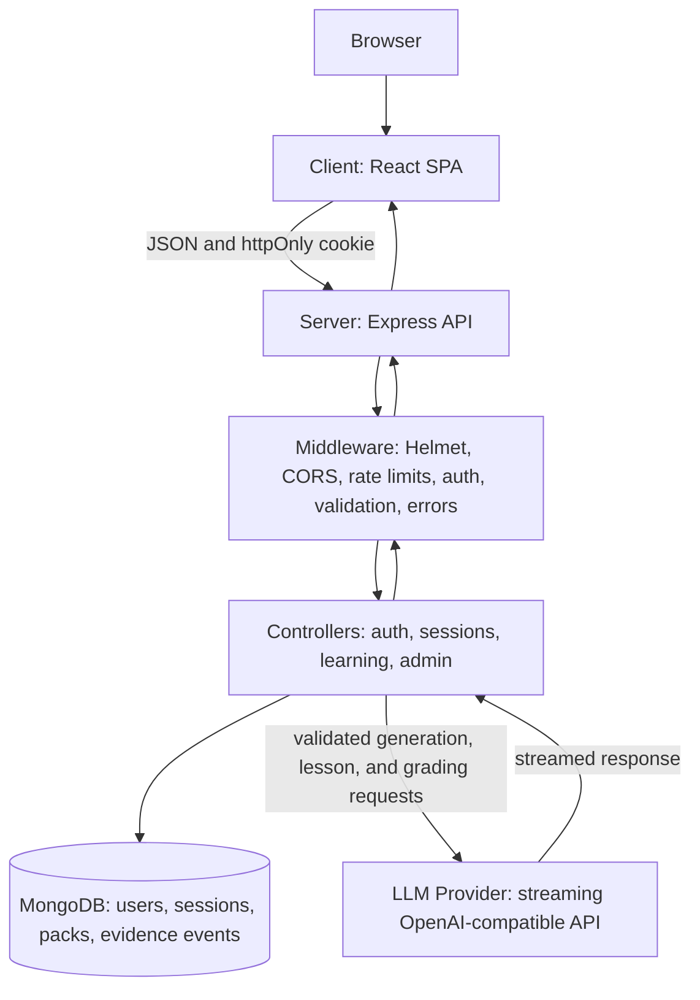
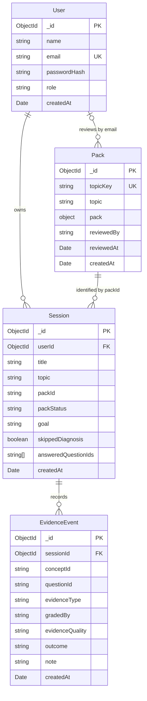

# Clario

Clario is an adaptive-learning web app for college students. It uses evidence from diagnostics and
checks to build a per-session learning plan, teach the next concept, and report a derived learner
view. Topic material is held in validated packs; the learning engine itself does not contain
topic-specific content.

## Team contributions

| Member | Contributions |
| --- | --- |
| Member A | Express API, learning engine, topic packs, and server data model |
| Member B | React SPA, student and admin experiences, and dashboard visualisations |
| Member C | Authentication and security basics, test coverage, documentation, and CI workflow |

## Tech stack

- **Client:** React 19, React Router, Vite, Recharts
- **Server:** Node.js 22+, Express 5, Mongoose, MongoDB, Zod
- **AI:** OpenAI-compatible streaming LLM provider (Strata in local development)
- **Security:** bcryptjs password hashes, JWT in an httpOnly cookie, Helmet, exact-origin CORS
- **Delivery:** Docker Compose and GitHub Actions

## Advanced Features

- **AI Integration:** adaptive diagnostics, lessons, and checks use the LLM for wording or grading
  where appropriate. Replies are strictly Zod-validated, retried once, and use server-authored
  fallback content when a response is unavailable or invalid.
- **Rate Limiting:** a global per-address limiter protects the API. Login and registration also
  have a dedicated limit of 5 failed attempts per 15 minutes, with `429` and `Retry-After`.
- **Automated Testing & Coverage Report:** server tests run with Node's built-in test runner and
  coverage instrumentation; the current suite reports over 96% line coverage. Run
  `cd server && npm run test:coverage` to see the full report.
- **Containerisation:** start MongoDB, API, and the production client proxy with one command:
  `docker compose up --build`.
- **Data Visualisation Dashboard:** `/admin/analytics` shows session trends, evidence quality,
  topic counts, and concept outcomes derived from MongoDB aggregation pipelines.

## Architecture



## Data model



`Pack.pack` contains the validated pack document. Sessions retain their pack ID and status as
provenance; they do not store a MongoDB reference to a pack row. Evidence is append-only, and
learner estimates are derived from it when requested.

## Local setup

Requirements: Node.js 22+, npm, MongoDB, and an OpenAI-compatible LLM endpoint for AI-backed
features. For a local model, Clario is configured for Strata by default.

1. Install dependencies and create the server environment file:

   ```bash
   cd server
   npm install
   cp .env.example .env
   ```

   Edit [`server/.env.example`](server/.env.example) values in `server/.env`. `MONGO_URL` and a
   `JWT_SECRET` of at least 32 characters are required. Generate a secret with:

   ```bash
   node -e "console.log(require('node:crypto').randomBytes(48).toString('hex'))"
   ```

2. Install the client and start both development servers in separate terminals:

   ```bash
   cd client && npm install && npm run dev
   ```

   ```bash
   cd server && npm run dev
   ```

   Open `http://localhost:5173`; the default CORS origin is exact and uses that hostname. The API
   listens at `http://127.0.0.1:3000` and `GET /health` returns `{ "status": "ok" }`.

3. To run the complete stack in containers, configure `server/.env` and run:

   ```bash
   docker compose up --build
   ```

   The client is served through the proxy at `http://localhost:8080`.
   If the LLM provider runs on the host machine, set `LLM_BASE_URL` in `server/.env` to
   `http://host.docker.internal:8080/v1` (or to the provider's reachable URL).

An admin can be seeded from the server package with `npm run seed-admin` after setting
`ADMIN_EMAIL` and `ADMIN_PASSWORD` in `server/.env`.

## Checks

```bash
cd client && npm run lint && npm run build
cd server && npm test
cd server && npm run test:coverage
```

GitHub Actions runs client lint/build and server tests with coverage on pushes and pull requests to
`main`. API routes and response formats are documented in [`docs/API_CONTRACT.md`](docs/API_CONTRACT.md).
